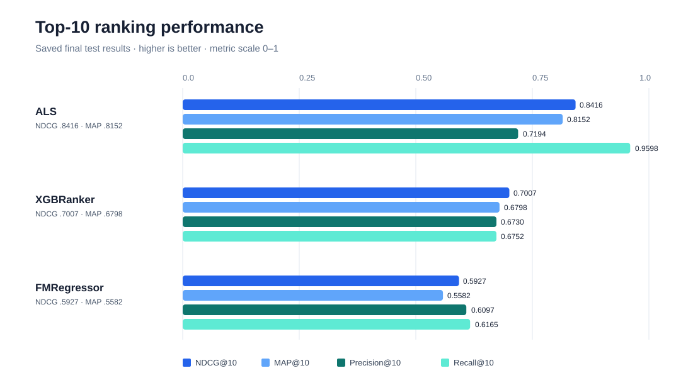
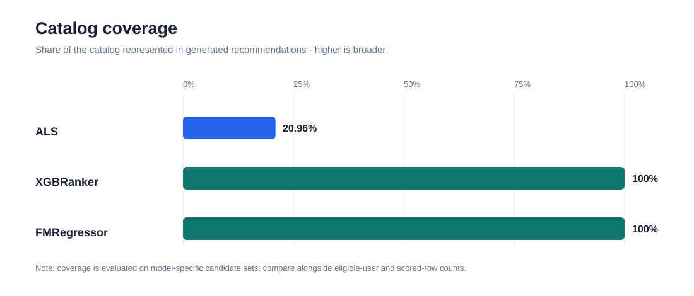

# Results

This directory contains metrics extracted from the saved outputs in the modelling notebook. These are historical notebook outputs, not results from a fresh run.

## Visual summaries

The ranking chart compares NDCG@10, MAP@10, Precision@10, and Recall@10. The coverage chart highlights the broader catalog reach of XGBRanker and FMRegressor. Interpret coverage together with candidate-set sizes; model evaluation populations differ.

## Data files

- `final_test_metrics.csv`: final held-out test metrics.
- `results.json`: machine-readable summary, selected validation configurations, and captured validation output.
- `validation_and_test_results.md`: readable experiment report.
- `visuals/`: SVG charts for the final test results.
